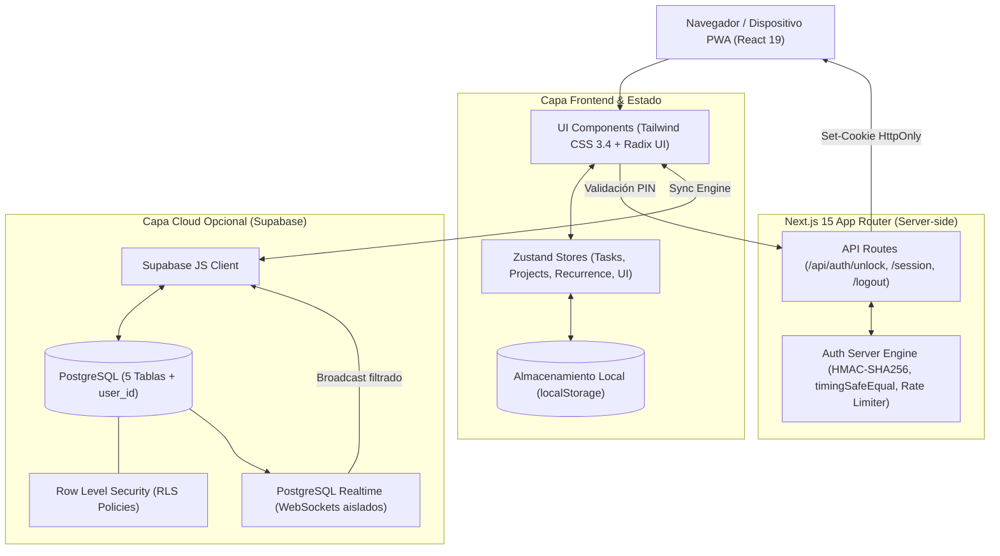

# Arquitectura y Documentación Técnica de Nidus

Documento de referencia para comprender el propósito, diseño de producto y la ingeniería interna de **Nidus**. Este documento está dividido en dos secciones: una explicación de **Nivel Básico / Producto** y un desglose de **Ingeniería Interna** pensado para revisión técnica por parte de otros ingenieros de software.

---

# PARTE 1: Nivel Básico (Visión General y Producto)

### 1. ¿Qué es Nidus?
**Nidus** es una aplicación web y PWA (*Progressive Web App*) de gestión personal del tiempo. Nace de dos vocablos latinos:
- ***Nidus*** («nido»): el refugio donde se incuba y protege lo que está por crecer (tus proyectos y aspiraciones personales).
- ***Agenda*** (del verbo *agere*, «las cosas que se han de hacer»): la lista consciente de compromisos inmediatos.

### 2. El problema que resuelve
La inmensa mayoría de herramientas de productividad sufren de dos grandes defectos:
1. **Sobrecarga y fatiga de gestión (Notion, ClickUp):** El usuario pasa más tiempo configurando propiedades, fórmulas, tableros y plantillas que ejecutando trabajo real.
2. **Modelos de suscripción de pago (Things 3, Todoist, Sunsama):** Bloquean funciones elementales como rutinas recurrentes o sincronización bajo cuotas mensuales obligatorias.

**Nidus elimina el ruido:** no hay menús infinitos ni configuraciones tediosas. Se abre y en menos de 1 segundo muestra exactamente lo que toca hacer hoy.

### 3. Conceptos clave de uso
- **Gestión por Energía (Bloques Mañana / Tarde / Noche):** En lugar de forzar citas horarias estrictas (como 10:15 - 10:45) que raramente se cumplen y generan frustración, Nidus organiza la jornada en tres bloques naturales según tu nivel de concentración.
- **Incubadora de Hábitos que se mantienen solos:** Define rutinas semanales (por ejemplo: gimnasio los lunes, miércoles y viernes; lectura diaria). Nidus las calcula y muestra en la agenda únicamente los días que corresponden, sin tener que crearlas a mano cada mañana.
- **Roadmap de Proyectos desacoplado:** Las metas estratégicas de un proyecto no saturan la agenda diaria. Cuentan con su propio tablero Kanban visual (*Por Empezar*, *En Curso*, *Conseguidas*) y el usuario decide qué meta mandar a su jornada de hoy con un solo toque.
- **Replanificación Sin Culpa:** Si una tarea queda inconclusa, no se marca con números rojos estresantes; con un toque se pospone al día adecuado con un mini-calendario visual.

### 4. Modelo de privacidad y funcionamiento híbrido
- **Modo Local-First (Por defecto):** Los datos se guardan directamente en el navegador del usuario (`localStorage`). Funciona offline, no requiere conexión ni registro y nadie más tiene acceso a la información.
- **Modo Sincronización en la Nube (Opcional):** Si el usuario desea tener su agenda sincronizada al segundo entre su teléfono móvil y su ordenador portátil, puede conectar su propia base de datos gratuita en Supabase.

---

# PARTE 2: Ingeniería Interna (Para Desarrolladores e Ingenieros de Software)



---

## 1. Stack Tecnológico y Razones de Elección

| Tecnología | Rol en Nidus | Por qué se eligió |
| :--- | :--- | :--- |
| **Next.js 15 (App Router)** | Framework fullstack | Permite renderizado estático híbrido (SSG para velocidad de carga instantánea `<100ms`) junto con API Routes seguras en el servidor Node.js para autenticación. |
| **React 19** | Biblioteca de UI | Concurrencia nativa, transiciones fluidas (`useTransition`), hidratación optimizada y soporte de Server/Client components. |
| **TypeScript 5** | Tipado estricto | Modelos de datos rigurosos para prioridades, bloques horarios, reglas de recurrencia y mappers hacia la base de datos. |
| **Zustand 5 + Persist** | Estado global reactivo | Elimina el boilerplate masivo de Redux. Permite selectores atómicos de grano fino para evitar re-renders innecesarios y persiste automáticamente en `localStorage`. |
| **Tailwind CSS 3.4** | Sistema de diseño | Variables semánticas HSL/CSS nativas (`var(--background)`, `var(--card)`, etc.) para cambio de tema claro/oscuro instantáneo y diseño adaptado a móviles con `env(safe-area-inset-*)`. |
| **Supabase (PostgreSQL 15)** | BaaS opcional | Persistencia relacional en la nube, seguridad por fila (RLS) nativa en la base de datos y suscripciones WebSockets (*PostgreSQL Changes*) en vivo. |
| **date-fns 4** | Motor de fechas | Modular, inmutable, tree-shakeable y preciso para cálculos de calendario y diferencias horarias con localización en español. |

---

## 2. Decisiones Arquitectónicas Fundamentales

### A. Paradigma Local-First con Sincronización Optimista
1. Todas las operaciones de lectura y escritura ocurren de forma síncrona en el cliente en los stores de Zustand (`useTaskStore`, `useProjectStore`, `useRecurrenceStore`).
2. El usuario percibe una latencia de **0 ms**: una tarea se tacha, se crea o se pospone al instante sin esperar respuestas de red ni mostrar *spinners* bloqueantes.
3. El motor de sincronización (`src/lib/sync-engine.ts`) actúa como un efecto secundario asíncrono (*fire-and-forget* con reconciliación): si Supabase está configurado, despacha la mutación (`upsert` o `delete`) en segundo plano.

### B. Proyección de Tareas Virtuales vs Persistencia Especulativa
Uno de los problemas más comunes en motores de tareas recurrentes es **"la explosión de filas"**: si un usuario crea un hábito de *"hacer ejercicio 3 veces por semana durante 5 años"*, una base de datos ingenua intentaría insertar 780 filas anticipadas en la tabla `tasks`.

**Solución en Nidus (`src/lib/recurrence-engine.ts`):**
- Las reglas de recurrencia se guardan como una única definición compacta (`RecurrenceRule`) que especifica frecuencia, intervalo y días de la semana.
- Las tareas de los hábitos recurrentes **no existen en la base de datos** hasta que es necesario: la función `generateVirtualTasks()` proyecta las tareas recurrentes en memoria **"al vuelo"** para el rango de fechas visible (día, semana o mes).
- **Idempotencia:** Cada tarea virtual recibe un ID determinista: `${ruleId}-${YYYY-MM-DD}`.
- **Completados:** Solo se persiste una fila compacta en la tabla `recurrence_completions` cuando el usuario marca la tarea como hecha ese día concreto. El lookup se realiza en tiempo constante $O(1)$ mediante un `Set` indexado por `${ruleId}:${date}`.

---

## 3. Modelo de Seguridad y Autenticación

### A. Servidor vs Cliente (Resolución de Vulnerabilidades)
Anteriormente, el acceso por PIN se evaluaba en el frontend y el valor por defecto estaba expuesto en el bundle JS. El nuevo diseño desacopla completamente el secreto del cliente:

```
[Usuario introduce PIN]
        │
        ▼ (POST /api/auth/unlock { pin: "XXXX" })
[Servidor Next.js Node Runtime]
  ├─ 1. Limiter Check: Comprueba ventana de intentos por IP
  ├─ 2. Hashing SHA-256 de input y expected PIN
  ├─ 3. Comparación en tiempo constante (crypto.timingSafeEqual)
  ├─ 4. Generación de Payload: { role: 'owner', exp: Date.now() + 30 días }
  ├─ 5. Firma criptográfica HMAC-SHA256 con AUTH_SECRET
  └─ 6. Emisión de cookie: Set-Cookie: nidus_session=<token>; HttpOnly; SameSite=Lax; Path=/
        │
        ▼ (Respuesta { success: true })
[Cliente Nidus Gatekeeper]
  └─ Se desbloquea la UI sin haber tenido acceso jamás al PIN en memoria ni en localStorage
```

### B. Mitigación de Fuerza Bruta (Brute-Force Protection)
Dado que un PIN numérico de 4 dígitos tiene un espacio de búsqueda finito (10.000 combinaciones), `/api/auth/unlock` implementa:
1. Retardo artificial deliberado de 400 ms en cada fallo.
2. Bloqueo temporal automático tras 5 intentos fallidos consecutivos por IP durante 60 segundos (HTTP 429).
3. Comparación mediante `crypto.timingSafeEqual` para prevenir ataques de temporización que deduzcan dígitos por discrepancias de microsegundos en la respuesta.

---

## 4. Arquitectura de Base de Datos y Supabase RLS

### A. Esquema Relacional (`supabase/schema.sql`)
Consta de 5 tablas principales vinculadas al usuario:
1. `public.projects`: Contenedores de proyectos personales (color, icono, descripción, `user_id`).
2. `public.project_goals`: Hitos del roadmap vinculados a un proyecto mediante clave foránea con borrado en cascada (`ON DELETE CASCADE`).
3. `public.tasks`: Tareas de la agenda con atributos de fecha, bloque horario, prioridad, etiqueta y estado de completado.
4. `public.recurrence_rules`: Plantillas JSONB y reglas cron lógicas para generación de hábitos.
5. `public.recurrence_completions`: Registro histórico de completados de reglas recurrentes.

### B. Políticas Row Level Security (RLS)
Para evitar que clientes con la clave pública `anon` puedan leer o escribir registros ajenos, cada tabla tiene habilitado RLS estricto:
```sql
CREATE POLICY "Users own tasks"
  ON public.tasks
  FOR ALL
  USING (
    (auth.uid() IS NOT NULL AND auth.uid()::text = user_id)
    OR auth.role() = 'service_role'
    OR (auth.jwt() ->> 'sub') = user_id
  )
  WITH CHECK (
    (auth.uid() IS NOT NULL AND auth.uid()::text = user_id)
    OR auth.role() = 'service_role'
    OR (auth.jwt() ->> 'sub') = user_id
  );
```

### C. Aislamiento de Realtime WebSockets
Supabase Realtime escucha los eventos de replicación de PostgreSQL. Para que dos usuarios distintos no reciban eventos cruzados en el canal de WebSockets:
- Cada suscripción se crea sobre un canal único por usuario: `nidus-realtime-sync-${userId}`.
- Cada escucha de tabla define su filtro a nivel de protocolo:
  `filter: 'user_id=eq.' + userId`

---

## 5. Estructura del Código Fuente

```text
src/
├── app/
│   ├── api/auth/                 # Endpoints protegidos en servidor
│   │   ├── unlock/route.ts       # Verificación segura de PIN y emisión de cookie
│   │   ├── session/route.ts      # Validación de cookie de sesión activa
│   │   └── logout/route.ts       # Invalidación y borrado de sesión
│   ├── today/page.tsx            # Agenda diaria agrupada en Mañana, Tarde, Noche
│   ├── week/page.tsx             # Planificador panorámico de 7 días
│   ├── month/page.tsx            # Calendario interactivo mensual
│   ├── recurring/page.tsx        # Gestor de reglas recurrentes y hábitos
│   ├── projects/page.tsx         # Tablero Kanban y roadmap de proyectos
│   ├── settings/page.tsx         # Gestión de temas, copias JSON y estado de sincronización
│   └── web/page.tsx              # Landing page pública de presentación y demo interactiva
├── components/
│   ├── auth/gatekeeper.tsx       # Teclado táctil PIN nativo, haptics y modal de acceso
│   ├── layout/                   # Sidebar responsivo, BottomNav móvil y Header
│   └── sync-provider.tsx         # Contexto de sincronización en segundo plano y reconexión
├── lib/
│   ├── auth-server.ts            # Motor criptográfico en servidor (HMAC, SHA-256)
│   ├── recurrence-engine.ts      # Algoritmo de cálculo de fechas y tareas virtuales
│   ├── sync-engine.ts            # Mappers DB, consultas Supabase y suscripciones Realtime
│   └── supabase.ts               # Cliente Supabase singleton
├── store/                        # Zustand stores (task-store, project-store, etc.)
└── types/                        # Definiciones TypeScript de entidades y contratos
```

---

## 6. Pruebas Automatizadas

Nidus utiliza el motor de tests nativo de Node.js (`node:test` y `node:assert/strict`) para máxima velocidad de ejecución y cero dependencias pesadas:
- `test/auth.test.mjs`: Verifica la igualdad en tiempo constante contra ataques de temporización y la integridad criptográfica de firmas HMAC-SHA256 frente a tokens manipulados.
- `test/recurrence.test.mjs`: Verifica el cálculo de bloques de energía y el filtro de tareas persistentes no completadas (*rollover*).

Ejecución de pruebas:
```bash
npm test
```
Resultados: **4/4 pruebas aprobadas en ~175 ms**.
